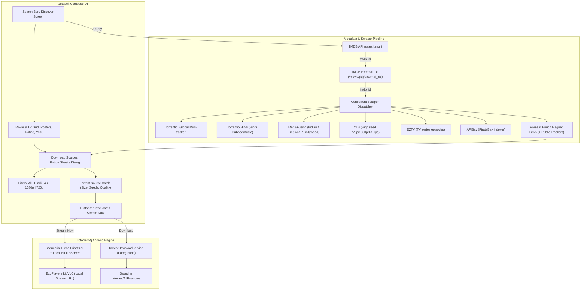

# Torrent Movie/Show Search, In-App Download & Live Streaming Blueprint

## 1. Overview & Selected Architecture

This document preserves the verified reverse-engineered architecture from **MyCinema** (`https://github.com/raj-Dcoder/MyCinema.git`) and maps it into **AllRounder Media Player** (`com.example.ymediaplayer`).

### User Decisions:
* **Download Engine**: **Option A — In-App Downloader (`libtorrent4j`)** with Android Foreground Service.
* **Live Streaming**: **Yes**, sequential torrent piece prioritization to allow playing inside ExoPlayer / LibVLC before download completes.
* **TMDB API Key**: Saved to `local.properties`: `tmdb.api.key=78bde186e39ce0078e38194bb8172f7d`.

---

## 2. End-to-End Flow Diagram



---

## 3. Required Dependencies & Components

### A. Network & Scrapers
* **OkHttp with DNS-over-HTTPS (DoH)**:
  Bypasses Indian ISP DNS blocks (Jio/Airtel) for TMDB and scrapers using Cloudflare `1.1.1.1`.
* **Kotlinx Serialization / Moshi**:
  For parsing TMDB JSON and Torrentio stream responses.

### B. In-App Torrent Engine (`libtorrent4j`)
* Library: `org.libtorrent4j:libtorrent4j` and `org.libtorrent4j:libtorrent4j-android`
* Native C++ Rasterbar libtorrent wrapper optimized for Android.
* Features:
  - Multi-threaded peer wire protocol
  - DHT, PeX, LSD, tracker scrape
  - Pause, Resume, Speed throttling
  - Sequential piece download (critical for video streaming while downloading)

---

## 4. Torrent Scrapers Reference URLs

1. **Torrentio**:
   `https://torrentio.strem.fun/sort=seeders|qualityfilter=cam,screener/stream/{type}/{imdbId}.json`
2. **Torrentio Hindi**:
   `https://torrentio.strem.fun/sort=seeders|language=hindi/stream/{type}/{imdbId}.json`
3. **MediaFusion**:
   `https://mediafusion.elfhosted.com/stream/{type}/{imdbId}.json`
4. **YTS**:
   `https://yts.mx/api/v2/list_movies.json?query_term={imdbId}&sort_by=seeds`
5. **EZTV**:
   `https://eztvx.to/api/get-torrents?imdb_id={numeric_imdb}&limit=100&page=1`
6. **APIBay**:
   `https://apibay.org/q.php?q={imdbId}`

### Built-in Public Trackers (Enrichment)
```text
udp://tracker.opentrackr.org:1337/announce
udp://open.demonii.com:1337/announce
udp://open.stealth.si:80/announce
udp://tracker.torrent.eu.org:451/announce
udp://exodus.desync.com:6969/announce
udp://tracker.moeking.me:6969/announce
udp://tracker.bitsearch.to:1337/announce
```

---

## 5. Implementation Roadmap (When Ready)

1. **Phase 1: TMDB & Scraper Network Layer**
   - Setup `DnsOverHttps` with Cloudflare `1.1.1.1`.
   - Implement `TmdbRepository` for search, trending, and external ID resolution.
   - Implement `TorrentScraperRepository` querying Torrentio, MediaFusion, and YTS concurrently.

2. **Phase 2: UI (Jetpack Compose)**
   - New "Discover / Downloads" tab in `MainActivity`.
   - Movie/Show search bar with trending carousel.
   - "Download Sources" BottomSheet with `All`, `Hindi`, `4K`, `1080p`, `720p` chips.

3. **Phase 3: Torrent Engine & Background Service**
   - Add `libtorrent4j` dependencies and initialize `SessionManager`.
   - Create `TorrentDownloadService` with foreground notification, download speed, and progress.
   - Implement storage manager to save finished files in device `Movies` directory.

4. **Phase 4: Sequential Streaming**
   - Prioritize first pieces (file header/metadata) and sequential video pieces.
   - Serve over embedded local HTTP server (`127.0.0.1:port`) into `VideoPlayerActivity`.
